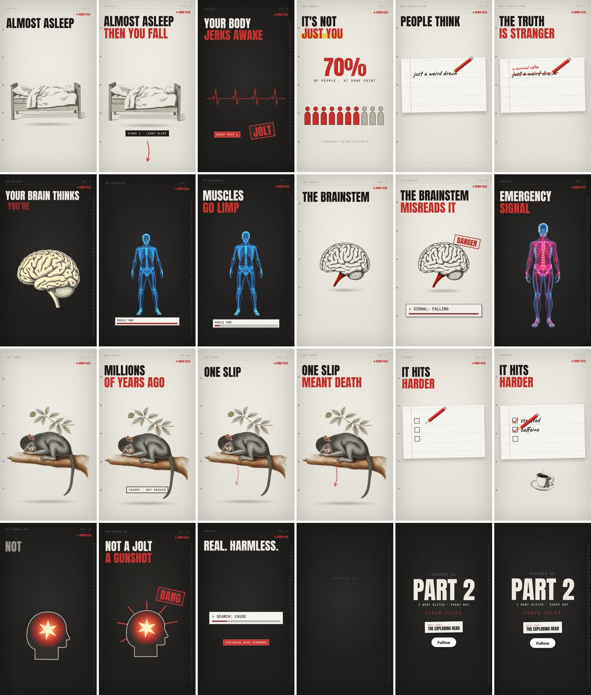
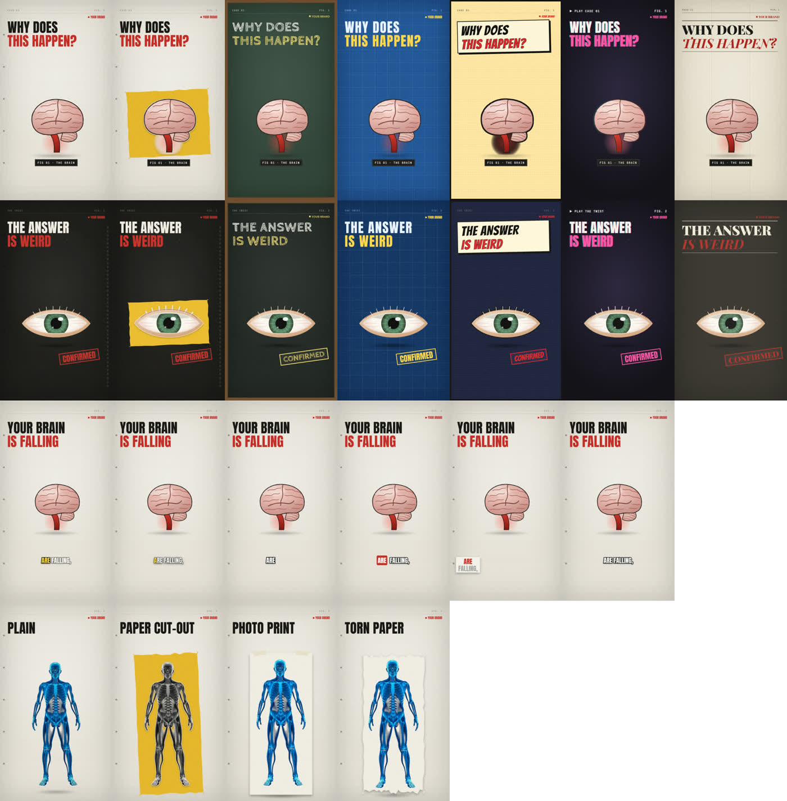
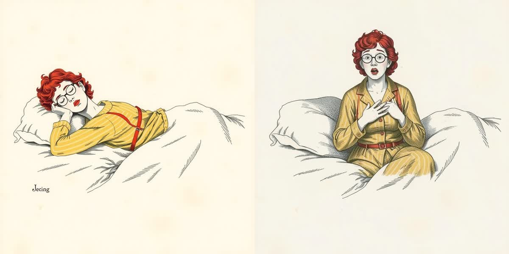
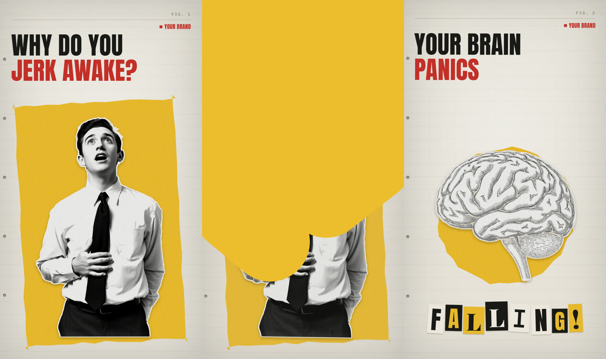

# 🎬 Cliffhanger: a curiosity reel studio for Claude

**Idea → research → story → script → voiceover → animated reel → social captions**, all in one
Claude skill.

Created with ❤️ by **[Shahzaib Anwar](https://github.com/ShahzaibAnwar)** ·
[YouTube](https://www.youtube.com/@m.shahzaibanwar) ·
[LinkedIn](https://www.linkedin.com/in/shahzaibanwar) ·
[dareecha.pk](https://dareecha.pk) ·
[shahzaib@dareecha.pk](mailto:shahzaib@dareecha.pk)

## Made with Cliffhanger

Real reels from the *Body Glitches* series, made end to end with this skill (script, voice,
animation, captions):

| | Reel | Language |
|---|---|---|
| ▶️ | [Why Your Body JERKS Awake While Falling Asleep 😳](https://youtube.com/shorts/nLGdQYpl4tM) | English |
| ▶️ | [Sote Waqt Sar Mein DHAMAKA? 💥 Exploding Head Syndrome](https://youtube.com/shorts/w5z2FsT1hLY) | Urdu / Hindi |

More on the channel: **[youtube.com/@m.shahzaibanwar](https://www.youtube.com/@m.shahzaibanwar)**

Cliffhanger makes faceless explainer reels in a "case file" style: notebook paper and dark film,
bold two-tone headlines that land on the spoken word, rubber stamps, a red pencil that writes and
strikes, terminal prompts, x-ray bodies and counters that count up. Every reel ends on a question
that sets up Part 2.



## What it does

| step | output |
|---|---|
| **Ideas** | Scored slate of 8–10 reel ideas: hook, twist and Part-2 cliffhanger for each |
| **Research** | `facts.md`: every claim with a source and confidence level |
| **Story & script** | Beat map (hook → myth → escalation → twist → bigger question → cliffhanger) plus a scorecard |
| **Voiceover** | ElevenLabs (with request stitching and word timestamps), or free Microsoft Edge neural voices |
| **Animated reel** | 1080×1920 MP4 at 30 fps: word-synced animation, synthesized SFX, a suspense drone ducked under the voice, mixed to ‑14 LUFS |
| **Captions** | Ready-to-paste text for Instagram, TikTok, YouTube Shorts, Facebook, X, LinkedIn and Threads, plus alt text, a pinned comment and an `.srt` |

Works in any language the voices support (English, Hindi/Hinglish, Urdu, Arabic, Spanish…).

**Motion:** scene transitions (whip, glitch, zoom, paper slide, page flip, flash), a slow camera push and
crash zooms, film dust and flicker on dark scenes, living grain, motion blur, spring entrances,
punch-word underline and highlighter effects, and a whiteboard-style **sketch** entrance that draws any
illustration in by hand.

**Sound:** 21 built-in effects placed automatically (whooshes, impacts, horror hits, heartbeat,
clock, buzz, glitch, typing, pencil…), per-scene sound cues and ambience, and optional **AI sound effects**
from ElevenLabs that are cached and reused (`node scripts/sfx.mjs preview` to hear them all).

**Art:** a shared art kit (hatching, gradients, a rough-ink filter) and a library of shaded
illustrations (`assets/art/`: arm, brain, dna, eye, glass, heart, magnifier, neuron, skull, syringe,
virus), plus `scripts/art-preview.mjs` to review drawings before they go into a reel.

**Series & languages:** `series.json` remembers every episode, voice per language and the cliffhanger
the next part must pay off. `localize.mjs` turns a reel into another language in one command (Roman
subtitles included), and `variants.mjs` renders alternative hooks for A/B tests.

**Video extras:** burned-in word-by-word subtitles that dodge on-screen chips, a designed cover and
grid-crop preview, platform safe-zone and long-scene checks, beats (several visuals per line),
newspaper clippings, comparisons, timelines, zoom lenses, map pins, and five music moods.

**Real photos, clips and sounds (free licences):** `photos.mjs` finds CC0 / public-domain / CC BY photos
(Openverse, NASA, Art Institute of Chicago), turns plain-background ones into paper cut-outs and the rest into
taped photo prints or torn paper, and writes the credits. Clips play as moving art. Every built-in sound effect
can use real CC0 recordings (Freesound via Openverse), and you can drop your own sound packs in `sfx-library/`.
No download possible? The skill prints search links and file names for an `art/inbox/` folder; it also writes
ready-to-paste prompt packs for the Gemini app and Veo, then imports what you save.

**Styles you can see before you choose:** `gallery.mjs` renders every look (case file, paper collage, chalkboard,
blueprint, comic, VHS, newsprint), caption style (word, karaoke, pop-in keywords, highlight box, tape, plain) and
picture finish into one self-contained page; Claude shows it and asks which you want. Or let it choose:
`style.mjs lock` picks the look, caption style and music for each video from its topic (history → newsprint,
tech → blueprint, unsolved → VHS…), using a map you can edit.



**Maps, charts, a talking mascot, real music:** world maps with highlighted countries and animated routes (bundled
public-domain outlines), line and bar charts from your CSV numbers, any character image as a paper puppet whose jaw
moves with the voice, and free CC0 / CC BY music by mood.

**Learns from your numbers:** import each video's retention (YouTube Studio export, or numbers read from your
insights screenshots); `analytics.mjs` shows which scenes lost viewers and writes `learnings.md` (which hooks, looks,
lengths and scene types work for *your* audience) for Claude to use when planning the next ones.

**Batch production:** `batch.mjs` produces every planned episode overnight (keeps the computer awake, resumes after a
stop) and ends with a review page of covers, scores and captions.

**Engagement check:** every stills pass scores the video against researched retention rules (hook timing,
a new visual every 2.5–4 s, length, narration speed, keyword headlines, the ending) with a fix for each miss.
See [`references/engagement.md`](references/engagement.md) for the rules and their sources.

**Long videos (16:9):** set `format` to 1920×1080 for YouTube: headlines move to a left column and art to the
right automatically, chapter cards, a YouTube-player safe-zone check and a 1280×720 `thumbnail.jpg`.

**AI illustrations:** `scripts/imagegen.mjs` generates engraved, cutaway, x-ray or photo-style
illustrations with **Cloudflare Workers AI** (FLUX schnell, about 170 free images a day) or **Google Gemini**
(paid, billing required). **Characters** stay the same person from scene to scene: the first image of a
character becomes the reference for the rest (FLUX.2 [klein], also free). Backgrounds are cut out
automatically so images sit on the paper or dark page, and hand-drawn SVGs remain the fallback.



**Collage look:** one setting (`"animation": { "look": "collage" }`) switches to a paper cut-out explainer
style: black-and-white halftone cut-outs with a paper edge on torn paint blocks, stop-motion animation on
twos, marker-scribble wipes and ransom-note payoff words. The `archival` image style makes documentary
photos whose backgrounds are removed without eating white shirts or pale faces.



**Fast, GPU-first rendering:** the browser draws on the dedicated graphics card, and video is encoded on the
dedicated GPU first (NVIDIA NVENC, AMD AMF, Apple VideoToolbox), then integrated graphics (Intel Quick
Sync, VAAPI, Windows Media Foundation), and the CPU only as the last resort. Frames are captured by several
browser tabs at once, about 2–3× faster than one. `npm run doctor` shows which GPU and encoder you'll get.

## Install

```bash
git clone https://github.com/ShahzaibAnwar/cliffhanger ~/.claude/skills/cliffhanger
cd ~/.claude/skills/cliffhanger/scripts && npm install
python3 -m pip install edge-tts        # Windows: python -m pip install edge-tts
npm run doctor                         # checks everything below and tells you how to fix what's missing
npm test                               # smoke test: renders the component gallery, no keys needed
```

Requirements: Node 18+, Python 3.9+, ffmpeg/ffprobe on PATH, and Google Chrome or Microsoft Edge
(Playwright drives your installed browser; it doesn't download one). You also need an internet
connection for Google Fonts and the TTS services.

| | ffmpeg | Python | browser |
|---|---|---|---|
| **Windows** | `winget install Gyan.FFmpeg` | `winget install Python.Python.3.12` | Chrome or Edge (Edge is built in) |
| **macOS** | `brew install ffmpeg` | `brew install python` | Chrome, or `npx playwright-core install chromium` |
| **Linux** | `sudo apt install ffmpeg` | `sudo apt install python3 python3-pip` | Chrome, or `npx playwright-core install chromium` |

Set `CHROME_PATH` to use a specific browser, and `PYTHON` to use a specific Python.

None of the API keys are required: without them you get free Microsoft Edge voices and hand-drawn art.

## Settings

```bash
node scripts/settings.mjs
```

This opens a local settings page in your browser, with tabs for **Voice · Brand · Content ·
Audio · Captions**. Paste your ElevenLabs voice IDs or links and pick a default. Tick **Ask me which
voice before each reel** and **Use only these voices**, add your API key (it's saved to a git-ignored
`.env`), and set your brand, language, length, series name, audio mix and caption platforms. Your
settings are saved to `settings.json`, which is git-ignored. See
[`references/settings.md`](references/settings.md).

## Use

In Claude Code:

> Give me 10 reel ideas about the human body
> Make a reel about why cats knead, in Hinglish, 45 seconds
> /cliffhanger write Part 2 of the hypnic jerk reel

Or run the scripts yourself:

```bash
python3 scripts/voiceover.py my-reel/                # TTS per scene, cached (Windows: python)
node scripts/render.mjs my-reel/ --stills            # QA: one frame per scene + contact sheet
node scripts/render.mjs my-reel/                     # final MP4 + SRT
node scripts/render.mjs my-reel/ --remux             # re-mix audio only
```

A reel is just a `reel.json` plus an `art/` folder. See
[`references/reel-json.md`](references/reel-json.md) for the schema, and
[`examples/hypnic-jerk`](examples/hypnic-jerk) for a complete 58-second reel
([watch the preview](examples/hypnic-jerk/out/hypnic-jerk-preview.mp4)).

## Layout

```
SKILL.md                    the workflow Claude follows
references/
  story-engine.md           idea formulas, beat map, curiosity devices, scorecard
  reel-json.md              scene schema and component catalog
  visual-style.md           art direction, SVG art rules, AI image prompts
  voiceover.md              ElevenLabs and Edge settings, voices per language
  sound-design.md           automatic SFX, presets, real recordings, AI sound cues, the sound pass
  engagement.md             researched retention rules (with sources) behind the engagement check
  settings.md               every setting and how to change it
  social-captions.md        platform specs and captions template
scripts/
  voiceover.py              TTS and word timings
  tighten.py                pacing pass: shorter pauses, faster delivery, timings remapped
  photos.mjs                free-licence photo finder: search, download, cut-out or print, credits
  gallery.mjs               style gallery: every look, caption style and finish as images/clips + one page
  style.mjs                 automatic style per topic (look + captions + music) from an editable map
  analytics.mjs             retention import, scene-by-scene drops, learnings across videos
  batch.mjs                 overnight production of many episodes + review page
  inbox.mjs                 hand-off folder: prompt packs for Gemini/Veo, imports your own files
  library.mjs               shared search, licence filter, download and credits (images + sounds)
  render.mjs                HTML engine → frames → ffmpeg, with audio mix, SRT, cover and contact sheet
  sfx.mjs                   sound presets, ElevenLabs sound effects and cache, preview
  art-preview.mjs           review sheet for SVG drawings (paper, dark, mid-sketch)
  settings.mjs              local settings page and CLI
  imagegen.mjs              AI illustrations (Cloudflare / Gemini) with cut-out, cleanup, auto re-roll
  series.mjs                series memory (series.json) for a workspace
  localize.mjs              one-command language versions
  variants.mjs              hook A/B variants
  gpu.mjs                   GPU-first encoder choice (dedicated GPU → integrated graphics → CPU)
  grid.mjs                  coordinate grid for an image, to place lenses, pins and arrows precisely
  doctor.mjs                setup check (npm run doctor)
  test.mjs                  smoke test (npm test)
  check-secrets.mjs         secret guard used by the pre-commit hook
  engine/                   the deterministic animation engine (CSS + JS + art kit)
assets/art/                 shared illustration library ("@lib/heart.svg")
assets/geo/                 world outlines for maps (Natural Earth, public domain)
examples/
  hypnic-jerk/              full example: reel.json, AI art, facts, captions, 720p preview
  component-gallery/        every component on one page
.githooks/pre-commit        runs the secret guard before every commit
```

## Notes

- The style is a genre. Use your own brand (`reel.brand`), and don't copy other creators' names,
  handles or scripts.
- Keep claims sourced. The skill writes a `facts.md` for every reel and labels estimates.
- If you use AI-generated images or music in your reels, check those tools' licences too.

## Your keys stay private

API keys live only in `.env` (git-ignored) or environment variables, and your voices and brand
live in `settings.json` (git-ignored). A pre-commit **secret guard** (`scripts/check-secrets.mjs`)
blocks any commit that contains a real key value, a key-shaped string, `.env`, `settings.json`,
caches or private paths. Turn it on once after cloning:

```bash
git config core.hooksPath .githooks
```

## Credits

**Cliffhanger** was created by **Shahzaib Anwar**.

| | |
|---|---|
| GitHub | [github.com/ShahzaibAnwar](https://github.com/ShahzaibAnwar) |
| YouTube | [youtube.com/@m.shahzaibanwar](https://www.youtube.com/@m.shahzaibanwar) |
| LinkedIn | [linkedin.com/in/shahzaibanwar](https://www.linkedin.com/in/shahzaibanwar) |
| Website | [dareecha.pk](https://dareecha.pk) |
| Email | [shahzaib@dareecha.pk](mailto:shahzaib@dareecha.pk) |

Built with Node.js, Playwright, FFmpeg, ElevenLabs, Microsoft Edge neural voices, Cloudflare Workers AI
(FLUX), Google Fonts (Anton, JetBrains Mono, Caveat, Playfair Display) and Claude.
Style inspired by the "case file" explainer genre on Instagram and YouTube Shorts; the collage look by
the paper-collage explainer genre.

## License

MIT, free and open source. Copyright © 2026 Shahzaib Anwar.
